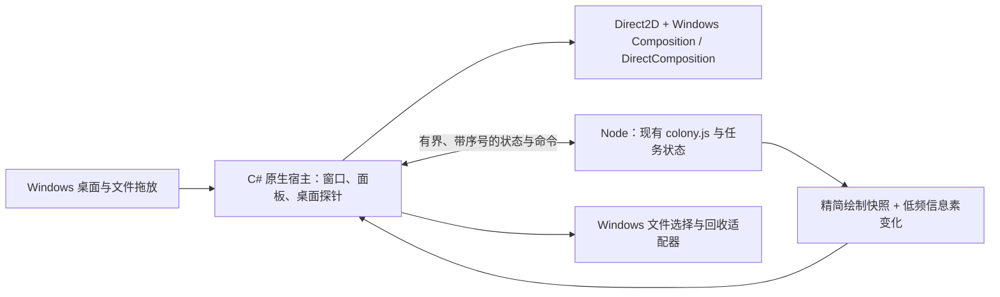

# 桌宠架构资源评估

日期：2026-11-06。范围：降低常驻内存、活跃 CPU 与合成开销，保留现有美术、动画、面板、真实桌面交互和文件安全语义。本轮是评估及隔离验证，没有切换生产架构。

## 判断

大幅下降有架构上的空间，但尚未获得原生完整版实测。最值得验证的是移除常驻 Chromium 绘制链路，采用 Windows 原生 GPU 绘制；不建议以重写蚁群算法为起点，也不建议把迁移 Tauri 等同于内存必然减半。

建议先验证“两进程迁移方案”：一个轻量 Node 进程保留当前 JS 模拟与任务状态，一个 C# 原生宿主处理桌面、GPU 绘制和面板。只有原型通过等效果、等负载比较后，才决定是否迁移完整程序。长期可再评估单进程或嵌入 JS 引擎，但不是第一步。

## 现有结构与证据

目前是一个透明全屏 Electron BrowserWindow，内部有地图画布、蚂蚁画布、DOM 搬运切片和面板。桌面显示与鼠标穿透由主进程控制，C# 探针负责 Explorer 图标与桌面状态；壁纸补片另行调用 C# 程序生成。

| 部分 | 已有证据 | 含义 |
|---|---|---|
| 蚁群算法 | 上轮 374 帧样本中 `step` 合计 55.1 ms，约 0.147 ms/帧 | 不是当下首要优化对象 |
| 绘制调用 | 地图 523.2 ms、蚂蚁 334.0 ms，合计 857.2 ms | 绘制调用耗时约为算法的 15.6 倍；不包含所有异步 GPU 成本 |
| Electron 内存 | 同场景上轮私有内存约 236.58 MiB | 浏览器、渲染、GPU、辅助进程均有成本，不能全算作算法占用 |
| 当前应用快照 | Electron 159.43 MiB + 桌面探针 23.08 MiB = 182.51 MiB 私有内存 | 实际状态与上轮负载不同，不能作为优化前后比较 |
| 精灵图集 | 上轮 125% 缩放约 0.63 MiB | 简化蚂蚁造型不会释放上百 MiB |
| JS 模块 | `colony.js` 使用 `globalThis`，无 DOM 依赖 | 可直接复用模拟，不必同时改算法 |

JS 堆约 10.6 MB 的旧样本只涵盖一部分 JS 内存，不能代表整个进程。`three` 仍列在依赖中，但当前页面加载的是 2D 精灵渲染器，没有加载 Three.js；删除未使用依赖主要改善磁盘和分发体积。

大画布仍有真实成本：1920×1080 的一个 RGBA 表面约 7.91 MiB，4K 约 31.64 MiB。双画布、交换缓冲和合成表面会增加占用；这些是尺寸推算，不是实际显存测量，不能简单相加当作当前进程内存。原生绘制也不可能把这些成本全部消除。

## 方案比较

| 方案 | 内存下降潜力 | CPU 改善方向 | 本项目判断 |
|---|---|---|---|
| 继续优化 Electron Canvas2D | 有限，浏览器常驻成本仍在 | 缓存、减少无效提交 | 适合渐进维护；上轮已实测约 7% 改善 |
| Electron 内改 WebGL 批绘 | 不确定，可能增加纹理或显存 | 大量信息素与精灵批次可能受益 | 不作为大幅降内存的首选；36 只蚂蚁已使用图集 |
| Tauri / WebView2 原样承载页面 | 可能下降，但无减半保证 | Chromium 页面绘制仍存在 | 安装包收益更确定，运行收益需同机验证 |
| Node 模拟 + C# 原生 GPU 宿主 | 较大，移除常驻浏览器链路 | 直接批绘、减少浏览器布局/合成中间层 | 推荐先做验证；有新增 IPC 和原生 UI 迁移成本 |
| 全部 C++/Rust 或 C# 原生重写 | 较大，理论上还能减少运行时/IPC | 可统一模拟与绘制调度 | 迁移风险最高，首轮不需要承担算法重写风险 |
| 原生桌宠 + 常驻 Web 面板 | 取决于 Web 面板是否真的退出 | 桌宠绘制改善 | 当前要求保留可见面板，常驻 WebView 会保留浏览器成本，不能按面板关闭时宣传收益 |

不要通过每只蚂蚁一个 HWND、全屏 GDI+ 每帧上传、强制关闭硬件加速来替代当前方案。前者扩大窗口管理成本；`UpdateLayeredWindow` 官方说明会更新整个窗口，建议窗口尽量小；后者在前轮实验已使内存和帧率变差。把模拟移入 Worker 可以隔离卡顿，但不是降低浏览器基线内存的办法。

## 推荐的迁移边界

- 宿主：复用现有 C# 桌面检测与图标读取逻辑，减少探针单独进程和反复启动壁纸工具。使用事件通知加低频兜底，保留返回桌面立即可见、隐藏时继续模拟的语义。
- 绘制：优先 Windows GPU API，Direct2D 绘制图集与动态图形，Composition 负责表面合成。微软面向现代桌面应用也提供 Windows.UI.Composition 方案，具体与 DirectComposition 的取舍由透明窗口、命中测试、设备丢失恢复原型确定，不预先承诺某个组合。
- 算法：原样保留 `colony.js`。第一阶段仍使用独立 Node，避免为嵌入 V8/QuickJS 增加接口与执行语义变化。已有纯算法测试继续执行。
- 状态传输：蚂蚁快照只包含位置、方向、动作、负重、入巢状态等绘制字段；信息素按既有约 300ms 节奏更新。先测量精简协议，必要时再采用二进制，不传全屏截图。视觉快照可丢弃过期帧，文件任务命令不可丢弃。
- 帧调度：原生呈现时钟驱动画面；模拟使用独立的真实经过时间。两端时间戳一致，插值不得跨越切割结束、拾取、入巢完成等状态事件。隐藏时不提交画面，恢复先提交最新状态。
- 美术：导出现有精灵图集和食物造型，保留动作参数。波纹、膜粘连、触角和食物举起仍动态渲染；不能用一张静态图片冒充保留效果。浏览器与 Direct2D 抗锯齿不同，需要实际尺寸与放大图对照。
- 面板：保留当前布局与半透明风格，采用原生绘制/控件。文字用 DirectWrite 或合适原生文本控件，并保留键盘焦点、辅助功能、拖放与按钮反馈。原生化不等于去掉面板；也不能将 WPF 全屏透明窗口默认当成轻量 GPU 方案。

原生化并不会自动解决 Explorer 图标替换问题。目前依靠精确壁纸补片覆盖原图标图像，文件名和命中区仍属于 Explorer。迁移中仍需维护图标位置、背景匹配、拖动时序；不把注入 Explorer 或修改系统图标作为前提。Win+D、窗口遮挡、DPI、Explorer 重启和多显示器变化都必须单独验证。

## 隔离实验：算法脱离浏览器

运行 `node tests/headless-architecture-benchmark.js`。Node v22.14.0，36 只蚂蚁、82 个障碍，先推进 180 秒模拟，然后采样 600 次 1/60 秒步进，同时序列化快照与低频信息素。不创建桌面窗口，不接触用户文件。

实测：

- 成功推进 10 秒模拟，600 次迭代；耗时 12.34 秒，实际约 48.6 次/秒。普通 Node 定时器在该环境下未达到严格 60Hz，因此不能把它直接当作新版绘制时钟。
- 模拟、快照与 JSON 编码调用合计约 523.6 ms；进程 CPU 时间 969 ms，约单核 7.85%。这里包含序列化、定时器及运行时成本，与 Electron 的 CPU 百分比口径不直接比较。
- 快照约 479 KiB/s，信息素约 325 KiB/s，总计约 804 KiB/s。只是序列化体积，没有测实际管道写入、解析与 GPU 上传。
- Node RSS 约 54.4 MiB、峰值约 55.8 MiB。RSS 不等同私有内存，也没有包含原生窗口、GPU、面板和文件服务，不能宣称新版完整程序仅占 55 MiB。

这个实验确认可复用算法，并暴露了完整 JSON 快照与普通定时器的成本；它不是原生版性能验收。原始记录：[headless 数据](../diagnostics/architecture-headless.json)、[当前进程快照](../diagnostics/architecture-live-processes.json)。

## 原生绘制原型实测（2026-11-10）

`prototypes/native-renderer` 已接入生产 `colony.js`，以 Node 输出状态快照，由 C# Direct2D + DirectComposition composition swap chain 绘制透明桌面叠层。它包含 36 只蚂蚁、生产蚂蚁/食物/传送门图集、双类信息素和两个模拟文件食物；障碍是合成桌面网格，不枚举 Explorer，也不执行文件操作。信息素纹理每 300ms 重建，帧循环只提交缓存纹理。预览面板只有必要状态与热键，不是生产控制面板。

最终一次 Direct2D 采样运行 76.4 秒，在 48Hz 屏幕上绘制 3,662 帧，约 47.9 FPS；Node 算法进程与原生宿主合计私有内存均值 75.4 MiB、峰值 81.9 MiB，单核 CPU 均值 15%。记录：[Direct2D 预览](../diagnostics/direct2d-preview-session.json)。另一条透明 WPF 路径运行 102.6 秒，约 37.2 FPS、私有内存均值 172.4 MiB / 峰值 286.4 MiB、单核 CPU 均值 98.7%，因此未作为候选架构。

这证明 Direct2D + DirectComposition 可承载本项目的透明桌面绘制，并且纹理缓存与垂直同步能保持信息素和动画刷新。预览内存均值相比此前 Electron + 桌面探针的一次 182.51 MiB 快照少约 59%，只是方向性证据：采样时间、障碍、桌面探针和进程构成不完全一致。CPU 也没有和 Electron 做同场景、同时间的三轮对照；GPU 内存、设备丢失和多屏 DPI 尚未测量。美术图集、动作帧、双类信息素、传送门动态和透明桌面效果已显示，边缘抗锯齿与完整面板交互还没有验收。

## 原型验收与迁移顺序

1. 隔离原生演出原型已完成首轮：复用生产算法和美术资产，不提供真实回收能力。透明 WPF 路径已淘汰，Direct2D + DirectComposition 路径保留。
2. 仍需与当前程序顺序运行相同负载。预热后采样至少 60 秒、重复三次，分别覆盖桌面可见、其他窗口覆盖、暂停、拖动文件与信息素密集场景。面板保持同样展开状态。
3. 决策目标（不是已实现结果）：同场景总私有内存中位数至少下降 40%，以 50% 为努力目标；活跃 CPU 时间至少下降 25%；P95 帧间隔不劣于原版，无视觉或交互回退。统计所有子进程，单独报告共享/专用 GPU 内存，不能用工作集换私有内存口径。
4. 达标后再接真实桌面探针、DPI、拖放、窗口显隐、壁纸补片。验证完整周期没有回到桌面需额外点击、图标露底、入巢残影或后台模拟停滞。
5. 最后迁移文件服务：提取现有桌面目录、固定磁盘、普通文件、身份一致性和最终确认规则；替换 Electron 的选择框与 `shell.trashItem` 为 Windows 适配器。回收通过 Shell API，失败必须保留原文件，不能回退永久删除。仅接到快照中的“完成”标志不能直接回收；要以服务端任务与实际送达字节为准，并在用户确认后再次核对身份。

文件适配器不是简单 API 改名：必须测试同名文件替换、重命名、目录重定向、确认期间变化、取消、重复命令、进程崩溃以及无法进入回收站等情况。Node 与宿主之间采用任务 ID 与有序状态机，不让绘制快照承担删除授权。全部通过后才替换桌面快捷启动入口。

如果原型收益达不到门槛，应保留当前实现；不因已写了一部分原生代码就继续完整重写。若两进程版本已经达标，也无需为了“单进程”再次重写算法。

## 成熟方案依据

已核对项目内 Canvas 图集、C# 探针、窗口显隐和文件验证代码。外部资料为官方文档，均在本轮读取，除 Node embedding 页面请求失败外；不依赖失败页面作结论。

- [Electron 进程模型](https://www.electronjs.org/docs/latest/tutorial/process-model)：继承 Chromium 多进程架构。
- [Tauri WebView 版本](https://v2.tauri.app/reference/webview-versions/)：Windows 使用基于 Chromium 的 WebView2。
- [WebView2 进程模型](https://learn.microsoft.com/en-us/microsoft-edge/webview2/concepts/process-model)：浏览器、渲染及 GPU 等辅助进程仍存在。
- [Direct2D 性能建议](https://learn.microsoft.com/en-us/windows/win32/direct2d/improving-direct2d-performance)：资源复用、图集和批处理，原生 API 也需要正确使用。
- [DirectComposition 能力](https://learn.microsoft.com/en-us/windows/win32/directcomp/why-use-directcomposition-) 与 [桌面 Visual Layer](https://learn.microsoft.com/en-us/windows/apps/desktop/modernize/visual-layer-in-desktop-apps)：Windows 硬件合成与 Win32/.NET 桌面接入路径。
- [UpdateLayeredWindow](https://learn.microsoft.com/en-us/windows/win32/api/winuser/nf-winuser-updatelayeredwindow)：全窗口更新成本。
- [IFileOperation](https://learn.microsoft.com/en-us/windows/win32/api/shobjidl_core/nn-shobjidl_core-ifileoperation)：迁移 Windows 文件操作适配器的官方接口入口；具体回收标志及失败行为还需在实现阶段核验。

网页摘录保存在 `diagnostics/architecture-sources.json` 与 `diagnostics/architecture-platform-sources.json`。
